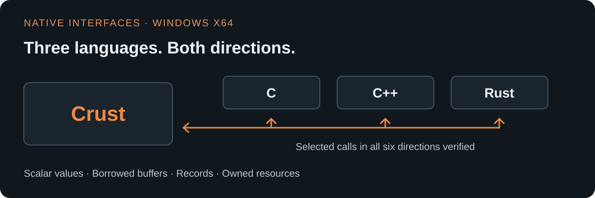

  

# Crust Progress

I'm building Crust, an experimental native systems language with C-style syntax
and `.cru` source files. The goal is a general-purpose language that works well
with existing C, C++, and Rust libraries.

This is the public development journal: what works, what has been checked, and
what still needs work. **Windows x64 is the supported target.** Implementation
and detailed technical design remain private during development, and no
compiler download is available yet.

**Explore:** [Progress journal](PROGRESS.md) · [Roadmap](ROADMAP.md) ·
[Measurements and limits](MEASUREMENTS.md)

## What works today

Verified on Windows x64 for selected subsets:

- **Native programs and libraries:** ahead-of-time compilation by default, with
  optional JIT execution.
- **C, C++, and Rust interoperability** in both directions.
- **Owned data and reusable libraries:** records, generics, collections, UTF-8
  text, formatting, JSON, files, clocks and TCP.
- **Concurrency:** threads, shared ownership, atomics, locks, channels and
  native callbacks.
- **Processing libraries:** filtering, phase discrimination and error-correcting
  codes.
- **Developer tools:** a formatter, a language server and editor integration.

  

These results cover limited subsets and environments. They do not establish
unrestricted library compatibility or a finished language.

## Latest checked progress

**November 5, 2026:** SDR: The Works v3 prepared playback checks passed.
See the [progress journal](PROGRESS.md) for dated milestones.

## What's next

Performance work continues. Live radio hardware has not started, and a public
release remains a separate later step. See the [roadmap](ROADMAP.md). No
release date is announced.

## SDR: The Works v3

A separate radio application being built with Crust on Windows x64. Offline
checks with synthetic inputs have passed. Live hardware, a complete receiver
and field voice or security correctness remain unverified. Crust's
general-purpose development stays independent of the receiver.

## Measured comparisons across languages

The published benchmark results are mixed. Several workloads remain behind C.
They do not establish a general language-wide speed or memory advantage. See
[Measurements](MEASUREMENTS.md) and the separate
[AOT/JIT comparison](JIT-COMPARISON.md).

## Follow the development

Star this repository to keep it handy, follow
[YahPager](https://github.com/YahPager), and visit the
[progress journal](PROGRESS.md) for dated updates.

| If you want to know… | Start here |
| --- | --- |
| What was verified, and when? | [Progress journal](PROGRESS.md) |
| What's planned and what's still open? | [Roadmap](ROADMAP.md) |
| How did the measured runs compare? | [Measurements and limits](MEASUREMENTS.md) |
| What changed with optional JIT execution? | [AOT/JIT comparison](JIT-COMPARISON.md) |

Source, detailed specifications, internal development records and binaries
remain private.
