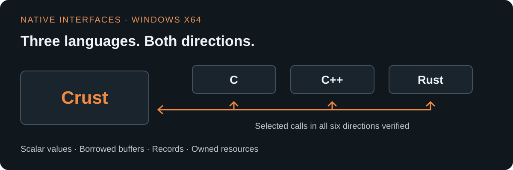
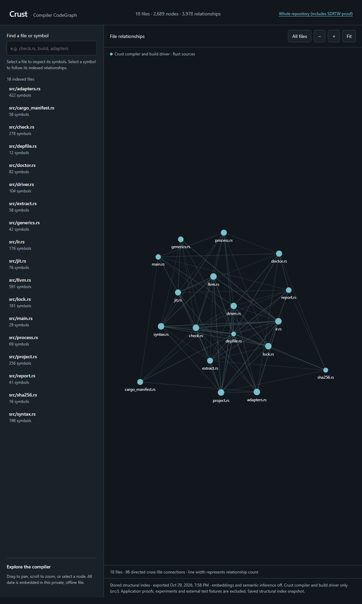

  

# Crust Progress

I'm building Crust, an experimental native systems language with C-style syntax
and `.cru` source files. The goal is a general-purpose language that works well
with existing C, C++, and Rust libraries.

This is the public development journal: what works, what has been checked, and
what still needs work. **Windows x64 is the supported target.** Implementation
remains private during development, and no compiler download is available yet.

**Explore:** [Progress journal](PROGRESS.md) · [Roadmap](ROADMAP.md) ·
[Measurements and limits](MEASUREMENTS.md)

## What works today

- **Compile and run native programs.** Crust builds programs, static libraries
  and Windows DLLs. Ahead-of-time compilation is the default; optional JIT
  execution is also verified for selected programs and interfaces.
- **Work with C, C++, and Rust in both directions.** Selected interfaces cover
  scalar values, borrowed buffers, records and owned resources. All six call
  directions have checks for results, errors and resource cleanup.
- **Use owned data and reusable libraries.** Selected records, generics,
  collections, UTF-8 text, formatting, JSON, files, clocks and synchronous TCP
  have passed Windows checks, including failure paths and ownership rejection.
- **Pass checked functions as values.** Selected named and stored function
  references preserve signatures, ownership and returned-view lifetimes, with
  explicit cloning and executable-lifetime checks in Windows AOT/JIT runs.
- **Run owned work on threads.** Selected workers move owned data, return
  values or errors, and cooperate with cancellation. Dropped handles stop and
  join their workers; failure and exact cleanup checks pass in Windows AOT/JIT.

  

These results cover the subsets and environments recorded in the
[progress journal](PROGRESS.md). They do not establish unrestricted library
compatibility or a finished language.

## Latest verified milestone: owned workers and cooperative stop

**October 31, 2026 — selected owned-worker checks pass on Windows x64.**

Workers move owned state and return checked values or application errors.
Tests cover cancellation, dropped handles, startup failure, failed joins and
shutdown recovery, with independent native cleanup counters in unoptimized and
optimized AOT/JIT runs.

The existing compiler, library, native-interface and framing checks also pass.
Shared state, communication and retained callbacks remain later Phase 6 work.
The earlier independent file-processing and TCP/JSON milestone remains
recorded in the journal.

[Read the milestone and its scope →](PROGRESS.md#october-31-2026---owned-workers-and-cooperative-stop-verified-on-windows)

## What's next

The next focus is shared state, synchronization, bounded channels and native
callback lifetimes. Phase 6 is in progress; these facilities still need
implementation and acceptance. The worker milestone establishes the selected
ownership and shutdown behavior described above.

Further processing libraries, developer tools and broader application
demonstrations remain on the [roadmap](ROADMAP.md#general-purpose-language-growth).
Public release is a separate readiness review; no release date is announced.

## A future proving ground: SDR: The Works

One early application proof exercised a bounded offline P25 Phase 2 framing
slice with synthetic inputs. Selected Windows runs checked orchestration,
validation, reset, event routing and native-library cleanup.

That proof is one step toward a future SDR: The Works v3 rebuild. Live hardware,
voice and security correctness, a complete receiver and host compatibility
remain unverified. The full rebuild stays deferred while Crust matures.

[Read the offline proof →](PROGRESS.md#october-28-2026---sdrtw-offline-framing-times-and-memory)

## Measured comparisons across languages

The published benchmark results are mixed. Several workloads remain behind C;
the audio-routing comparisons use different settings and older control runs.
They do not establish a general language-wide speed or memory advantage.

The original tables, measurement boundaries and caveats are preserved in
[Measurements](MEASUREMENTS.md). The separate
[AOT/JIT comparison](JIT-COMPARISON.md) records its own results and limits.

## A look inside the first week

View the compiler CodeGraph snapshot

Captured October 29, 2026: **18 source files, 2,689 nodes and 3,978 indexed
relationships**. This compiler-only snapshot excludes the SDRTW proof,
experiments and external fixtures. It shows structure at that checkpoint,
rather than runtime behavior or the compiler's current size.

## Follow the development

Star this repository to keep it handy, follow
[YahPager](https://github.com/YahPager), and visit the
[progress journal](PROGRESS.md) for dated updates.

| If you want to know… | Start here |
| --- | --- |
| What was verified, and when? | [Progress journal](PROGRESS.md) |
| What's planned and what's still open? | [Roadmap](ROADMAP.md) |
| How did the measured runs compare? | [Measurements and limits](MEASUREMENTS.md) |
| What changed with optional JIT execution? | [AOT/JIT comparison](JIT-COMPARISON.md) |

Source, detailed specifications, internal development records and binaries
remain private. Earlier Fedora results in the journal are historical: Linux
support was withdrawn on October 31, 2026. New updates distinguish planned,
implemented and verified work.
